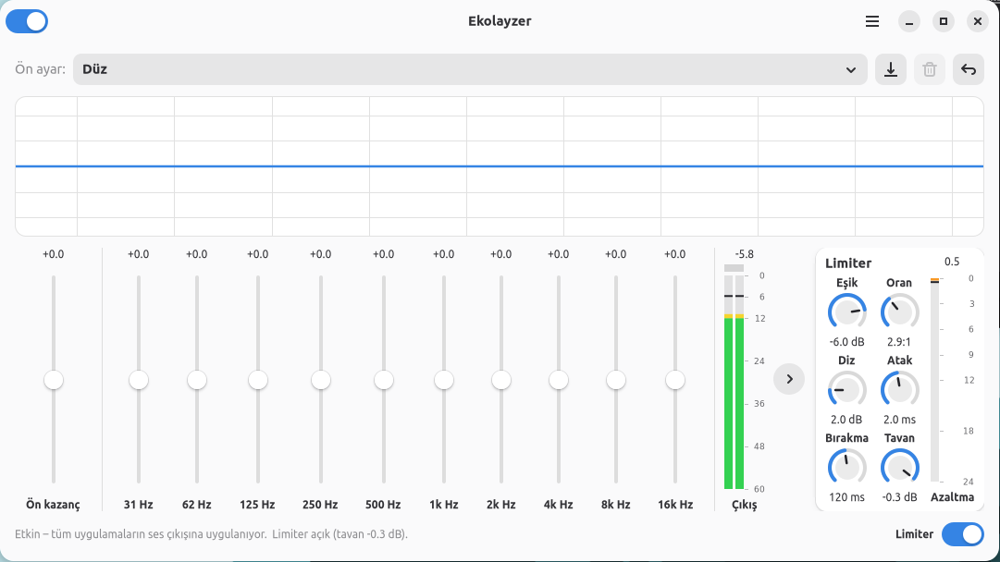

# Ekolayzer

Pardus için sistem geneli ses ekolayzeri ve limiter. Tüm uygulamaların ses çıkışına (tarayıcı, müzik ve video oynatıcılar, oyunlar…) otomatik olarak uygulanır ve tek bir `.deb` dosyasıyla kurulur.



## Özellikler

- **10 bantlı ekolayzer** (31 Hz – 16 kHz, ±12 dB), ön kazanç ve canlı frekans yanıtı eğrisi
- **13 hazır ön ayar** (Bas Güçlendirme, Vokal, Rock, Gece Modu…) ve kendi ön ayarlarını kaydetme
- **Limiter**: stereo bağlı, ileri bakışlı (lookahead) tepe sınırlayıcı. Eşik, oran (∞:1'e kadar), diz, atak, bırakma ve tavan döner düğmelerle ayarlanır; çıkış hiçbir zaman tavanı aşmaz, yani kırpılma olmaz
- **Göstergeler**: hızlı tepki veren stereo çıkış seviyesi (kırpılma ışığı ve tepe tutma ile) ve kazanç azaltma göstergesi
- Ayar değişiklikleri **sesi kesmeden anında** uygulanır
- Ses motoru **her oturum açılışında arka planda otomatik başlar**; pencereyi açman gerekmez
- Kurulumda **masaüstü kısayolu** eklenir
- **Hafif**: ses motoru çalarken tek çekirdeğin ~%0,75'ini kullanır; sessizlikte %0. Arayüz açıkken ek olarak ~%1,75 CPU ve ~80 MB bellek

## Kurulum

[Releases](../../releases) sayfasından son `ekolayzer_<sürüm>_amd64.deb` dosyasını indir, sonra çift tıklayıp Pardus Paket Kurucu ile kur ya da terminalde şunu çalıştır:

```bash
sudo apt install ./ekolayzer_1.2.1_amd64.deb
```

Pardus 25 GNOME'da gereken her şey sistemde zaten kurulu olduğundan **internet bağlantısı gerekmez**.

Kurulumdan sonra ses motoru hemen devreye girer. Masaüstündeki veya uygulama menüsündeki **Ekolayzer** simgesiyle ayar penceresini açabilirsin.

### Gereksinimler

- Pardus 25 (veya Debian 13 tabanlı bir dağıtım), amd64
- PipeWire ≥ 1.0 ve WirePlumber ≥ 0.5
- GTK 4 ve libadwaita ≥ 1.5 (`gir1.2-gtk-4.0`, `gir1.2-adw-1`)

## Kullanım

| Denetim | İşlev |
|---|---|
| Sol üstteki anahtar | Ekolayzeri tamamen açar/kapatır |
| Kaydırıcılar | Ön kazanç ve 10 bandın kazancı |
| Ön ayar menüsü | Hazır veya kaydedilmiş ön ayarı seçer; 💾 ile geçerli ayarı kaydeder |
| Çıkış göstergesinin yanındaki ok | Limiter panelini açar/kapatır |
| Döner düğmeler | Sürükle (Shift: ince ayar), fare tekerleği veya ok tuşları; çift tıklama varsayılana döndürür |
| Sağ alttaki **Limiter** anahtarı | Limiteri açar/kapatır |
| Kırmızı kırpılma ışığı | Çıkış 0 dBFS'ye ulaştı; tıklayınca sıfırlanır |

Ayarlar `~/.config/ekolayzer/settings.json` dosyasında kullanıcı başına saklanır. Yedeklemek veya başka bir bilgisayara taşımak için bu dosyayı kopyalaman yeterli.

## Nasıl çalışır?

- Ses işleme, ayrı bir PipeWire sürecinde **filter-chain** modülüyle yapılır. Filtre, WirePlumber'ın *smart filter* özelliğiyle varsayılan çıkış aygıtının önüne otomatik eklenir; bu yüzden tüm uygulamalar etkilenir ve çıkış aygıtı değişince filtre onu izler.
- Ekolayzer bantları PipeWire'ın yerleşik biquad süzgeçleridir.
- Limiter ve seviye ölçümü, pakette gelen küçük bir C **LADSPA eklentisidir** (`src/dyn/ekolayzer_dyn.c`). Ölçümler arayüze paylaşılan bellek üzerinden iletilir; ek süreç veya kayıt akışı gerekmez.
- Ses motoru `ekolayzer.service` adlı bir systemd kullanıcı hizmetidir. Arayüz yalnızca ayarları değiştirir; pencere kapalıyken de ses işlenmeye devam eder.

## Kaynaktan derleme

Debian/Pardus üzerinde:

```bash
sudo apt install gcc libc6-dev dpkg-dev
./build-deb.sh
```

Sonuç: `ekolayzer_<sürüm>_<mimari>.deb`.

## Kaldırma

```bash
sudo apt remove ekolayzer
```

Kaldırınca ayar dosyan silinmez; yeniden kurarsan ayarların geri gelir. Tamamen temizlemek için `~/.config/ekolayzer` klasörünü sil.

## Lisans

[GPL-3.0-or-later](LICENSE) © 2026 Gökdeniz G.
